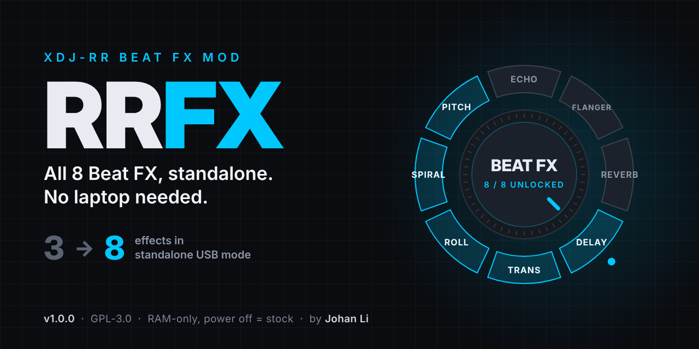

# RRFX: all 8 Beat FX on the Pioneer XDJ-RR

The XDJ-RR's Beat FX switch only reaches 3 effects (Echo, Reverb, Flanger), but its
audio engine contains 8. RRFX makes all 8 selectable from the front panel:

**Reverb · Trans · Roll · Flanger · Echo · Delay · Spiral · Pitch**

Each one gets its correct on-screen name, its own BEAT ◀/▶ parameter steps (beats or %),
FX ON/OFF, LEVEL/DEPTH and quantize, the same way the 3 stock effects do.

> **RAM-only.** This is not custom firmware and nothing is flashed: RRFX runs in the
> unit's memory only, and a power cycle returns it to stock firmware 1.08.
> **Provided as-is, with no guarantees. Use at your own risk** (see [Disclaimer](#disclaimer)).
> Not affiliated with or endorsed by Pioneer DJ or AlphaTheta.

## Requirements

- Pioneer **XDJ-RR with firmware 1.08** (check the version in the unit's system
  information / UTILITY screen). Any other firmware is refused automatically:
  the script checks the player program's checksum before doing anything.
- A USB stick formatted FAT32.

## Install (once per power-on)

1. Download `RRFX_v1.0.0_usb.zip` from the [Releases](../../releases) page.
2. Copy **`autoexec.bin`** and **`RRFX_ARM.txt`** to the **root** of the USB stick.
3. Power on the XDJ-RR and wait until it has **fully booted**.
4. Insert the stick and wait until the USB light and indicator stop blinking. The stick
   then has a new folder `RRFX_UI_V100/attempt-1/`. Its `log.txt` should end with
   `RESULT=LOADED_USE_THE_ARROWS_HOLD_BOTH_1_2S`.
5. Remove the stick (optional). The mod stays active until you power off.

Re-inserting the stick later in the same session is safe: it sees the mod is already
loaded and only writes a new log.

## Use

1. **Hold BEAT ◀ and ▶ together for 1.2 s**, then release. You're now in select mode.
2. **Tap ◀ / ▶** to step through the 8 effects. Only the name on screen changes;
   nothing audible happens while browsing.
3. **Hold ◀ + ▶ for 1.2 s again** and release. The shown effect is applied.

- 10 s without touching anything cancels select mode, and nothing changes.
- Moving the physical **Beat FX type switch** always returns to the stock 3 effects.
  You can select again at any time.
- Outside select mode the arrows work as usual (beat length or %).
- **Pitch** steps through −50, −25, −10, +10, +25, +50, +75, +100 %. Its first value
  after power-on is −50 %; after that it remembers the last value.
- **Backup method:** put `RRFX_SELECT.txt` on the stick containing `1`–`8` or an effect
  name (e.g. `Spiral`) and insert it. That effect is selected.

### rekordbox (PC / USB) mode

When the XDJ-RR is connected to rekordbox, rekordbox controls the effects itself
(including all of its own Beat FX), and RRFX stays out of the way: the arrows and FX ON go
to rekordbox. **When you disconnect rekordbox, RRFX works again immediately**, with no
need to re-insert the stick. Tested with rekordbox 7.2.18.

## Known behaviour (this is how Pioneer's engine works, not a mod issue)

- Beat ranges come from the engine: Echo/Delay 1/16–8, Trans/Roll 1/16–16,
  Flanger 1/16–64 (no 3/4), Spiral 1/16–16; Reverb 1–100 %; Pitch −50…+100 %.
- Some beat steps are drawn grey depending on the tempo (Pioneer's visual help).
- **Roll** works like a small sampler: it captures audio when FX ON is pressed, and the
  arrows change the loop length from that point. Its LEVEL/DEPTH reaches 100 % effect
  at the knob's halfway point.
- **Delay/Echo** LEVEL/DEPTH: the effect level rises to about 3/4 of the knob, then the
  dry track fades out.
- Reverb always runs without quantize (the quantize label is grey), as on stock.
- On CH SELECT = MASTER the effect processes the mix of both decks.

## Troubleshooting: the last `RESULT=` line in `log.txt`

| RESULT | Meaning |
|---|---|
| `LOADED_USE_THE_ARROWS_HOLD_BOTH_1_2S` | Working. |
| `NOT_ARMED` | `RRFX_ARM.txt` is missing from the stick root. |
| `RBP_IDENTITY_REFUSED` | Not firmware 1.08. Nothing was changed. |
| `OLDER_RRFX_BUILD_..._REBOOT_FIRST` | A test build was loaded since power-on. Power-cycle, then insert again. |
| `INJECT_FAILED_CHECK_LOG` / `HOOKS=NOT_CONFIRMED...` | Something unexpected; nothing was changed. Please open an issue with the log folder. |
| `SELECT_OK_<name>` | `RRFX_SELECT.txt` selection applied. |

If something looks wrong, power-cycle the unit: that always returns it to stock.

### Debug log for bug reports

Also put an empty file named `RRFX_DEBUG.txt` on the stick. While it's there, every
mixer button press is also logged. Insert the stick again at the end so the log is
copied, then attach the newest `RRFX_UI_V100/attempt-N/` folder to your issue.

## Help wanted: untested

- **Long sessions (2 h and more).** Tested sessions so far run up to about an hour.
  Reports are very welcome.

## For developers

- [docs/HOW_IT_WORKS.md](docs/HOW_IT_WORKS.md): architecture, hooks, addresses, safety checks.
- [docs/BUILDING.md](docs/BUILDING.md): building from source and the test bench.
- [docs/TESTING.md](docs/TESTING.md): what has been tested on hardware.
- [CHANGELOG.md](CHANGELOG.md)

## Disclaimer

RRFX is provided **as-is, without warranty of any kind**, express or implied (see sections
15 and 16 of the [LICENSE](LICENSE)). It is not custom firmware and nothing is written to
the unit's flash memory: it runs in RAM only, and a power cycle always returns the unit to
stock firmware 1.08. Problems are therefore unlikely to be permanent, but **the author takes no
responsibility for any failure, damage or loss**, including a unit freezing or misbehaving
during a live performance. If you use it at a gig, test it thoroughly on your own setup
first, and know that powering the unit off and on returns it to stock.

## Credits

Made by **Johan Li** ([linktr.ee/djjohanli](https://linktr.ee/djjohanli)). Coded with the help
of **Claude** (Anthropic's AI assistant): the reverse engineering, code, tests and
documentation were written together with Claude.

Bug reports and questions: please open a [GitHub issue](../../issues) (with the log folder),
not via social media.

## License

GPL-3.0-or-later, see [LICENSE](LICENSE). This repository contains only original source
code. It contains no Pioneer/AlphaTheta firmware, binaries, keys or graphics.
